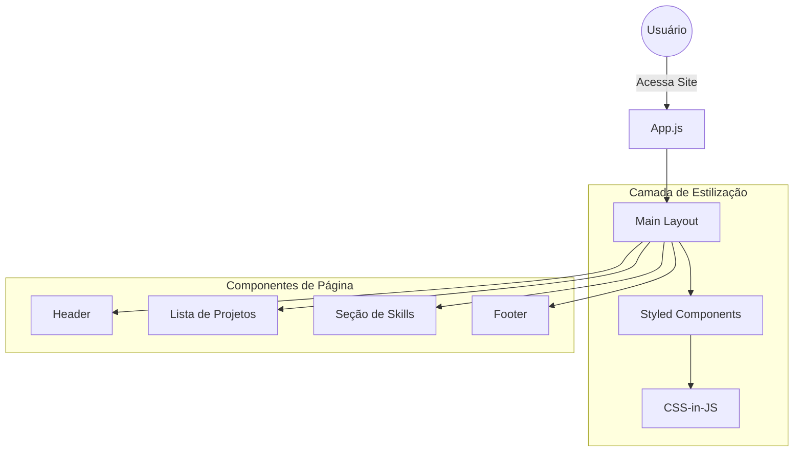

# Portifólio Profissional

Plataforma de apresentação pessoal desenvolvida com React e Styled Components, focada em exibir projetos e competências técnicas com uma identidade visual customizada.

---

## 📖 Sobre o Projeto

O projeto Portifólio é uma aplicação de página única (SPA) criada para consolidar a presença digital do desenvolvedor. Diferente de templates genéricos, este projeto foca na implementação de estilos customizados via CSS-in-JS, permitindo a criação de interfaces únicas que refletem a personalidade e o rigor técnico do autor.

O objetivo é proporcionar aos recrutadores e parceiros uma navegação fluida e visualmente atraente por entre os projetos realizados, utilizando as versões mais recentes do ecossistema React para garantir performance e modernidade.

O público-alvo são empresas de tecnologia, recrutadores e a comunidade de desenvolvedores.

---

## ✨ Funcionalidades

- **Design Customizado**: Interface desenvolvida do zero utilizando Styled Components, garantindo total controle sobre cada pixel da aplicação.
- **Apresentação de Projetos**: Galeria de trabalhos realizados com descrições, tecnologias utilizadas e links para repositórios.
- **Seção de Competências**: Exibição clara das linguagens, frameworks e ferramentas dominadas.
- **Navegação Fluida**: Transições rápidas entre seções da página sem recarregamentos, graças ao roteamento eficiente do React.
- **Otimização de Renderização**: Utilização do React 19 para garantir que a interface seja responsiva e eficiente em qualquer dispositivo.

---

## 🏗 Arquitetura

A aplicação segue o padrão de **Componentização do React**, onde a interface é dividida em blocos independentes e reutilizáveis. A estilização é injetada diretamente nos componentes, eliminando a necessidade de arquivos CSS externos e evitando conflitos de classes.



---

## 📂 Estrutura do Projeto

```text
.
├── src
│   ├── components         # Componentes de interface reutilizáveis
│   ├── assets             # Imagens, ícones e arquivos de mídia
│   ├── App.jsx            # Componente principal e orquestração da página
│   └── main.jsx           # Ponto de entrada da aplicação
├── public                 # Arquivos estáticos públicos
├── index.html             # Template HTML base
├── vite.config.js         # Configurações do build e servidor Vite
└── package.json           # Dependências e scripts do projeto
```

---

## 🛠 Tecnologias Utilizadas

| Tecnologia | Finalidade |
|------------|------------|
| React 19 | Biblioteca para construção da interface de usuário |
| Styled Components | Implementação de CSS-in-JS para estilização dinâmica e isolada |
| Vite | Ferramenta de build e servidor de desenvolvimento de alta velocidade |
| JavaScript | Linguagem de programação principal |

---

## 📦 Dependências Principais

- **react-dom**: Essencial para a renderização do React no navegador.
- **styled-components**: A biblioteca core para a criação de componentes estilizados.
- **vite**: Responsável por otimizar o bundle final e proporcionar o HMR (Hot Module Replacement).

---

## ⚙ Fluxo da Aplicação

Início $\rightarrow$ Carregamento de Componentes $\rightarrow$ Injeção de Estilos via Styled Components $\rightarrow$ Renderização da Interface $\rightarrow$ Interação do Usuário com a Galeria de Projetos.

---

## 🚀 Como Executar

### Pré-requisitos

- Node.js instalado

---

### Clonando o projeto

```bash
git clone <url-do-repositorio>
cd Portifolio/portifolio
```

---

### Instalando dependências

```bash
npm install
```

---

### Executando em modo de desenvolvimento

```bash
npm run dev
```
A aplicação estará disponível no endereço indicado pelo Vite (geralmente `http://localhost:5173`).

---

## 🔍 Decisões Arquiteturais

- **Escolha do Styled Components**: A decisão por CSS-in-JS foi tomada para garantir que cada componente fosse encapsulado com seus próprios estilos, facilitando a manutenção e evitando o "efeito cascata" indesejado de CSS global.
- **Uso do Vite**: Substituiu o Create React App para reduzir drasticamente o tempo de inicialização do servidor de desenvolvimento e acelerar o processo de build.
- **React 19**: A atualização para a versão mais recente do React permite o uso de novos hooks e melhorias de performance na renderização da árvore de componentes.

---

## 💡 Boas Práticas Utilizadas

- **Componentização Atômica**: Divisão da interface em pequenos componentes independentes, promovendo a reusabilidade.
- **Separação de Preocupações**: Lógica de negócio e dados de projetos separados da camada de apresentação.
- **Otimização de Assets**: Uso de compressão de imagens para garantir que o portfólio carregue rapidamente mesmo em conexões lentas.

---

## 📚 Aprendizados

Ao analisar este projeto, é possível aprender sobre:
- A implementação de estilização dinâmica com Styled Components.
- O fluxo de trabalho moderno de desenvolvimento front-end com Vite.
- A criação de interfaces responsivas e centradas no usuário para autopromoção profissional.
- A transição para as novas versões do React e suas melhorias de performance.

---

## 👨‍💻 Autor

[Guilherme](https://github.com/guilherme-dev)
